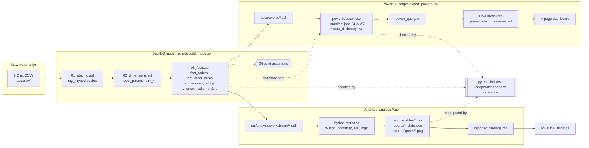

# Data lineage and source-to-report traceability

This document shows how data flows from the nine raw Olist CSVs to the findings reports and the Power BI dashboard. It also traces each headline figure in the README back to the exact SQL, model column and raw field it comes from, and to the test that pins it.

Column definitions are in [`docs/data_dictionary.md`](data_dictionary.md) for the model and [`powerbi/data/data_dictionary.csv`](../powerbi/data/data_dictionary.csv) for the dashboard package.

## 1. Overview

## 2. Layer by layer

| # | Layer | Produced by | Inputs | Outputs | Controls |
|---|---|---|---|---|---|
| 1 | Raw | Kaggle download (manual) | none | `data/raw/*.csv` (git-ignored) | byte-identity fixture in `tests/conftest.py` |
| 2 | Staging | `sql/01_staging.sql` | raw CSVs | `stg_*` (typed, unfiltered) | row counts equal source (BA) |
| 3 | Dimensions | `sql/02_dimensions.sql` | staging; IBGE regions (external) | `model_params`, `dim_date`, `dim_state`, `dim_zip_geo`, `dim_product`, `dim_seller` | unique keys (BA) |
| 4 | Facts | `sql/03_facts.sql` | staging, dimensions | `fact_order_items`, `bridge_order_seller`, `fact_reviews`, `fact_orders`, `v_single_seller_orders` | grain, referential integrity and invariants (BA); anchors (`tests/anchors.py`) |
| 5a | Analysis SQL | `analysis/<workstream>.py` running `sql/analysis/<workstream>/*.sql` | `fact_orders`, `v_single_seller_orders`, `fact_reviews`, `model_params` | DataFrames | independent pandas recomputation (`tests/reference_pandas.py`) |
| 5b | Analysis outputs | the same scripts | 5a | `reports/tables/<prefix>_*.csv`, `reports/<workstream>_stats.json`, `reports/figures/<prefix>_*.png` | `tests/test_<workstream>.py` |
| 5c | Findings reports | `analysis/build_<workstream>_report.py` | 5b and a pytest run | `reports/<workstream>_findings.md` | the report embeds the test result |
| 6a | Power BI export | `scripts/export_powerbi.py` running `sql/powerbi/*.sql` | model tables; prioritisation results | `powerbi/data/*.csv`, `manifest.json`, `data_dictionary.csv`, `power_query.m` | schema = dictionary; SHA-256 per file (`tests/test_powerbi_export.py`) |
| 6b | Semantic model | Power BI Desktop (Power Query + DAX) | 6a | 6 relationships, measures in `powerbi/dax_measures.md` | DAX logic reconciled through Python and SQL equivalents; not executed in Desktop (manual checklist in `powerbi/README.md` §9) |
| 6c | Dashboard | Power BI Desktop | 6b | 4 pages; `docs/dashboard/*.png`, `powerbi/visualisation/*.pdf` | screenshots compared with the verified findings (`reports/final_portfolio_audit.md` §10) |

Workstream names and file prefixes:

| Workstream | Script | SQL folder | Output prefix | Stats file |
|---|---|---|---|---|
| Delivery reliability | `analysis/delivery_reliability.py` | `sql/analysis/delivery/` | `delivery_` | `reports/delivery_reliability_stats.json` |
| Customer satisfaction | `analysis/customer_satisfaction.py` | `sql/analysis/satisfaction/` | `satisfaction_` | `reports/satisfaction_stats.json` |
| Geography and sellers | `analysis/geographic_seller.py` | `sql/analysis/geography/` | `geo_` | `reports/geo_stats.json` |
| Operational prioritisation | `analysis/operational_prioritization.py` | `sql/analysis/prioritization/` | `prio_` | `reports/prio_stats.json` |

## 3. Source-to-report traceability for headline figures

Each row follows one figure from the README back to its raw fields. "Stats key" is the JSON path in the stats file, and "Pinned by" names the test that fails if the figure changes.

| README figure | Value | Stats key / table | Analysis SQL | Model columns (`fact_orders` unless stated) | Raw fields (`olist_orders_dataset.csv` unless stated) | Pinned by |
|---|---|---|---|---|---|---|
| Delivered orders in window | 96,203 | `delivery_reliability_stats.json` → `overall.n_delivered` | `sql/analysis/delivery/headline.sql` | `is_delivery_kpi_eligible` = `in_window` AND `is_delivered_dated` | `order_status`, `order_purchase_timestamp`, `order_delivered_customer_date` | `tests/anchors.py` (`delivered_dated_window`); `test_delivery_reliability.py::test_base_population_and_overall` |
| Late orders / late-delivery rate | 6,531 / 6.79% | `overall.n_late`, `overall.late_rate` (0.067888) | `headline.sql` | `is_late_calendar` (`delivered_date` > `estimated_date`) | `order_delivered_customer_date`, `order_estimated_delivery_date` | `test_delivery_reliability.py::test_base_population_and_overall`; `test_powerbi_export.py` (DAX `Late-delivery rate` = 6,531 / 96,203) |
| Severely late (>7 days) | 2.97% (2,860) | `overall.severe_rate`, `overall.n_severe` | `severity.sql` | `is_severe_late`; `model_params.severe_late_days` = 7 | as above | `test_delivery_reliability.py::test_severity_bands_partition`; `test_powerbi_export.py` |
| Single-seller orders | 94,931 | `geo_stats.json` → `population_single_seller.n_delivered` | `sql/analysis/geography/single_seller_orders.sql` | `is_seller_kpi_eligible`; `v_single_seller_orders` | `olist_order_items_dataset.csv`: `order_id`, `seller_id` | `tests/anchors.py` (`single_seller_window`); `test_operational_prioritization.py::test_level_populations` |
| Cross-state vs same-state late rate | 8.2% vs 4.6% | `geo_stats.json` → `mh_cross_state.rate_exposed`, `.rate_unexposed` | `geography/shipment_type.sql` | `v_single_seller_orders.is_cross_state` (`seller_state` ≠ `customer_state`) | `olist_sellers_dataset.csv`: `seller_state`; `olist_customers_dataset.csv`: `customer_state` | `tests/test_geographic_seller.py` |
| Rio de Janeiro late rate | 12.1% on 12,310 orders | `reports/tables/geo_states.csv` (RJ row) | `geography/state_summary.sql` | `customer_state`, `is_late_calendar` | `olist_customers_dataset.csv`: `customer_state` | `tests/test_geographic_seller.py`; Wilson check on (1,495, 12,310) in `test_powerbi_export.py` |
| Reviewed orders P0 / P1 | 95,037 / 90,103 | `satisfaction_stats.json` → `populations.one_review_p0`, `.p1_after_removing_early` | `sql/analysis/satisfaction/analysis_base.sql` | `is_review_kpi_eligible`, `is_review_p1_eligible`, `review_before_delivery_flag` | `olist_order_reviews_dataset.csv`: `order_id`, `review_creation_date` | `test_customer_satisfaction.py::test_populations_match_pandas` |
| 1–2 star share, on-time vs late (P0) | 9.2% vs 62.4% | `reports/tables/satisfaction_group_summary.csv` (`P0 primary`, `low_share`) | `satisfaction/group_summary.sql` | `review_score`, `is_late_calendar` | `olist_order_reviews_dataset.csv`: `review_score` | `test_customer_satisfaction.py::test_group_summary_matches_pandas`, `::test_primary_anchor_values` |
| Largest lane: SP>RJ excess late orders | +596 (14.3% late on 8,031) | `reports/tables/prio_candidates_lane.csv` (`SP>RJ`) | `sql/analysis/prioritization/src_lane.sql`, `candidates_template.sql` | `v_single_seller_orders.seller_state`, `customer_state`, `is_late_calendar` | sellers and customers state fields | `test_operational_prioritization.py::test_wilson_and_excess_formulas`, `::test_candidate_counts_match_pandas` |
| Investigate tiers (states / lanes / sellers) | 10 / 9 / 8 | `reports/tables/prio_candidates_*.csv` (`tier`); dashboard `snap_tier_counts.csv` | `prioritization/*.sql` | as above, plus window-half consistency | as above | `test_operational_prioritization.py::test_tiers_match_independent_rule_implementation`; `test_powerbi_export.py` |

### How to trace a new number

1. Find the figure in a findings report. Its footer names the SQL folder, tables, figures and stats file.
2. Look up the stats key or table row, then the `.sql` file named in the generating script (`run_sql(con, "<name>")` loads `sql/analysis/<workstream>/<name>.sql`).
3. The SQL reads model columns. Look them up in [`docs/data_dictionary.md`](data_dictionary.md), which gives the business rule and the raw fields behind each one.
4. For a dashboard number, start from the DAX measure in `powerbi/dax_measures.md`. It reads columns described in `powerbi/data/data_dictionary.csv`, which are exported by `sql/powerbi/<table>.sql` from the same model columns.

## 4. Reconciliation between the two paths

The report path (§2, rows 5a–5c) and the dashboard path (rows 6a–6c) both read `fact_orders`. They are reconciled as follows:

- `tests/test_powerbi_export.py` recomputes the dashboard KPIs from the exported CSVs and asserts the same anchors as the reports (99,441 / 99,092 / 96,203 / 6,531 / 2,860).
- The prioritisation tiers are **precomputed** once (`snap_*` tables) instead of being recalculated in DAX. The dashboard therefore cannot drift from the report under slicers.
- The DAX text has been reconciled through Python and SQL equivalents only. Executing it in Power BI Desktop is a manual step (`powerbi/README.md` §9).
