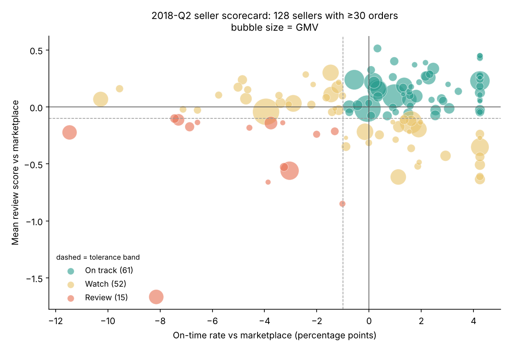
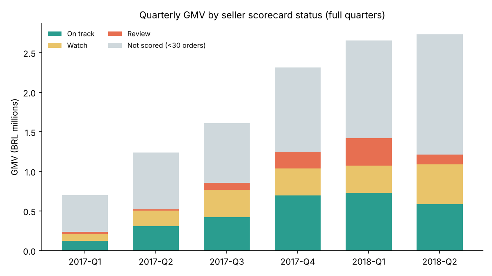

# Seller (partner) scorecard and quarterly business review

Generated by `analysis/seller_scorecard.py`. Population: eligible single-seller orders (94,931; 2017-01 to 2018-08). GMV is the sum of item prices in BRL, excluding freight. All results are descriptive. A status label is a prompt for a business-review conversation, not a verdict on a seller.

## Rules (fixed before looking at results)

- A seller is scored in a quarter only with at least 30 orders in that quarter.
- Benchmarks are the marketplace's own quarterly on-time rate and mean review score (P0: orders with exactly one review row).
- **On track** = meets both benchmarks, **Watch** = misses one, **Review** = misses both. A seller meets a benchmark when it is no more than 1.0 pp below the on-time rate or 0.10 points below the mean review.
- *Revision note:* the first version used strict cut-offs (any shortfall). It labelled the two largest sellers Review for gaps of 0.1 pp and 0.01 points, which is noise at these volumes, so the tolerance band was added before the results were written up.
- The QBR compares 2018-Q2 (latest full quarter) with 2018-Q1. 2018-Q3 holds only July-August purchases and is marked partial.

## Marketplace by quarter

| Quarter | Orders | Active sellers | GMV (BRL) | GMV QoQ | On-time rate | Mean review |
|---|---:|---:|---:|---:|---:|---:|
| 2017-Q1 | 4,928 | 614 | 701,560 |  | 96.2% | 4.20 |
| 2017-Q2 | 8,908 | 770 | 1,239,172 | 76.6% | 96.1% | 4.21 |
| 2017-Q3 | 12,049 | 967 | 1,611,782 | 30.1% | 96.6% | 4.30 |
| 2017-Q4 | 17,063 | 1,223 | 2,315,396 | 43.7% | 91.2% | 4.09 |
| 2018-Q1 | 20,385 | 1,338 | 2,652,828 | 14.6% | 87.0% | 3.95 |
| 2018-Q2 | 19,300 | 1,640 | 2,733,335 | 3.0% | 95.8% | 4.27 |
| 2018-Q3 (partial) | 12,298 | 1,582 | 1,657,438 | -39.4% | 95.1% | 4.34 |

## 2018-Q2 QBR snapshot

- Marketplace GMV was BRL 2,733,335, 3.0% vs 2018-Q1.
- On-time benchmark 95.8% (was 87.0%); review benchmark 4.27 (was 3.95). 2018-Q1 includes the Feb-Mar 2018 high-delay months, so most of the on-time recovery is marketplace-wide; that is why status is measured against the benchmark rather than in absolute terms.
- 128 of 1640 active sellers met the 30-order threshold. Together they hold 44.4% of GMV and 52.9% of orders.
- Status: 61 On track (48.2% of scored GMV), 52 Watch (41.3%), 15 Review (10.5%).
- The top 10 sellers by GMV hold 14.8% of marketplace GMV; 6 of them are On track.
- 80 sellers were scored in both quarters: median GMV change -14.6%, 74 improved their on-time rate.

### Top 10 sellers by GMV, 2018-Q2

| Rank | Seller | Orders | GMV (BRL) | GMV QoQ | On-time | vs bench (pp) | Mean review | Status |
|---:|---|---:|---:|---:|---:|---:|---:|---|
| 1 | 955fee92 | 488 | 61,596 | 59.5% | 95.7% | -0.1 | 4.26 | On track |
| 2 | 7d13fca1 | 342 | 61,237 | 83.5% | 91.8% | -3.9 | 4.23 | Watch |
| 3 | 4869f7a5 | 305 | 49,629 | -21.1% | 96.7% | +1.0 | 4.37 | On track |
| 4 | 1025f0e2 | 303 | 43,464 | 74.9% | 97.4% | +1.6 | 4.14 | Watch |
| 5 | da8622b1 | 280 | 34,137 | -16.4% | 96.1% | +0.3 | 4.42 | On track |
| 6 | fa1c13f2 | 104 | 34,091 | -9.3% | 95.2% | -0.6 | 4.51 | On track |
| 7 | e882b2a2 | 36 | 33,292 | 93.2% | 100.0% | +4.2 | 4.50 | On track |
| 8 | edb1ef5e | 49 | 29,513 | 61.8% | 95.9% | +0.2 | 4.49 | On track |
| 9 | 7c67e144 | 151 | 29,410 | -43.3% | 92.7% | -3.0 | 3.71 | Review |
| 10 | 966cb476 | 38 | 27,843 | 356.3% | 100.0% | +4.2 | 3.92 | Watch |

### Largest Review-status sellers by GMV, 2018-Q2

| Seller | Orders | GMV (BRL) | On-time | vs bench (pp) | Mean review | vs bench |
|---|---:|---:|---:|---:|---:|---:|
| 7c67e144 | 151 | 29,410 | 92.7% | -3.0 | 3.71 | -0.56 |
| 2eb70248 | 113 | 18,192 | 87.6% | -8.1 | 2.60 | -1.67 |
| 06a2c3af | 191 | 17,953 | 84.3% | -11.5 | 4.05 | -0.22 |
| 634964b1 | 100 | 13,934 | 92.0% | -3.8 | 4.13 | -0.14 |
| 7ad32824 | 78 | 11,531 | 88.5% | -7.3 | 4.16 | -0.11 |
| c31eff83 | 63 | 6,805 | 88.9% | -6.9 | 4.10 | -0.17 |
| 391fc663 | 77 | 6,049 | 88.3% | -7.4 | 4.17 | -0.10 |
| 855668e0 | 40 | 5,298 | 92.5% | -3.3 | 3.74 | -0.53 |
| 4e922959 | 36 | 4,770 | 94.4% | -1.3 | 4.06 | -0.21 |
| 2e1c9f22 | 32 | 3,738 | 93.8% | -2.0 | 4.03 | -0.24 |

## Figures

## Limitations

- Single-seller orders only; multi-seller orders (1.3%) are not attributed.
- Delivery timestamps are order-level, so seller handling and carrier transit cannot be separated: a Watch or Review status on on-time rate may reflect the carrier or the lane, not the seller.
- Review means on small samples move a lot; the 30-order threshold limits but does not remove this.
- No targets, costs or contracts exist in the data, so benchmarks are marketplace averages, not commercial targets.
